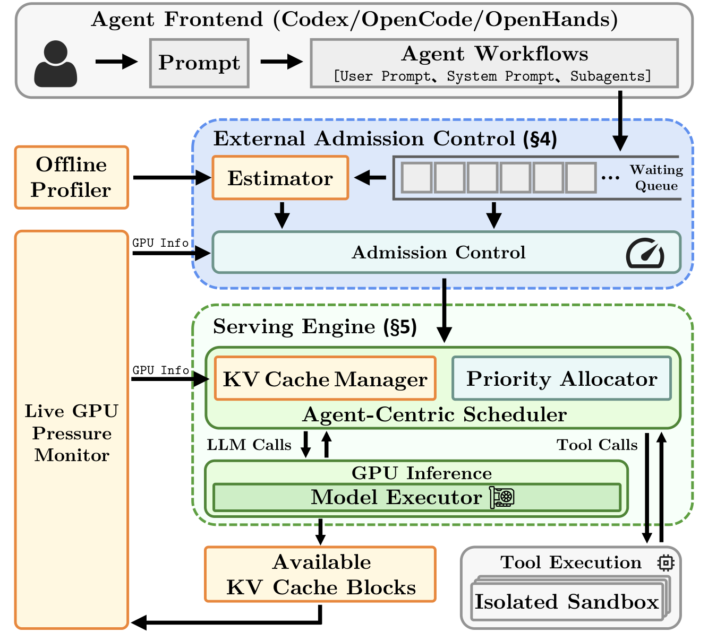
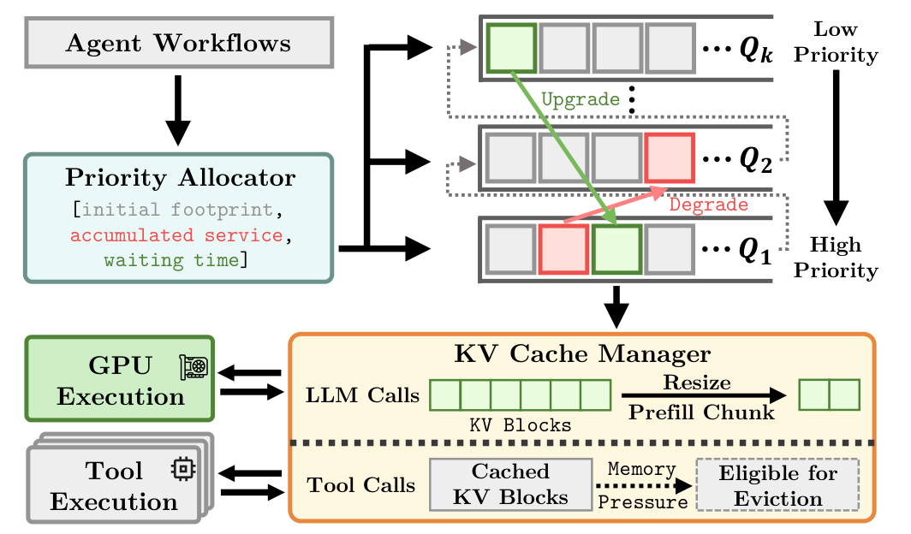

# MARS: Towards High Goodput and Low KV Thrashing in Agent Serving under GPU Memory Constraints

**MARS** is an agent serving system that coordinates workflow admission and
in-engine scheduling to achieve high workflow-level goodput on
memory-constrained GPUs while avoiding KV cache thrashing. It is built on vLLM
and serves real agent frontends (OpenHands, OpenCode, and Codex) without
requiring a predeclared agent graph.

This repository is a preview release for the
[MARS paper](https://arxiv.org/abs/2604.26963). It includes the MARS-modified
vLLM source code, the baselines evaluated in the paper, the task-driver
testbed, the OpenHands/OpenCode/Codex integrations, and a compact hybrid
workload.

---

## Why MARS

Self-hosted agents run many concurrent, multi-turn workflows. Each workflow
keeps growing its context across turns, so the combined KV demand easily
outgrows GPU memory. Throughput-oriented engines then evict the reusable
prefixes of workflows that are waiting on tools and rebuild them when those
workflows return: **KV cache thrashing**. A large share of prefill work then
goes into rebuilding context the engine has already computed. Large batches
also slow individual decode turns, so workflows miss their end-to-end latency
budgets even when token throughput stays high.

MARS keeps the active working set within GPU memory and runs smaller,
right-sized batches, shifting serving from *evict-and-recover* to
*admit-and-finish*.

## Results

Speedup of MARS in mean end-to-end latency over the fastest baseline at each
arrival rate, serving Qwen3-Coder-30B-A3B-Instruct through unmodified agent
frontends. ILR-1 to ILR-4 are 400-workflow workloads with increasing input
lengths.

**OpenHands** on H200. Baselines: FCFS, Autellix, Infercept, LightLLM,
Continuum, and Continuum-Dy.

| Workload | 0.2 RPS | 0.25 RPS | 0.33 RPS | 0.5 RPS | 1 RPS |
|---|---|---|---|---|---|
| ILR-1 | 1.35× | 1.32× | 1.27× | 1.20× | 1.29× |
| ILR-2 | 1.38× | 1.47× | 1.49× | 1.40× | 1.40× |
| ILR-3 | 1.68× | 1.44× | 1.51× | 1.49× | 1.51× |
| ILR-4 | 1.87× | 1.64× | 1.61× | 1.48× | 1.54× |

**OpenCode and Codex** on H100 with ILR-1. Baselines: FCFS,
Continuum + CONCUR, and Continuum-Dy + CONCUR.

| Frontend | 0.1 RPS | 0.2 RPS | 0.25 RPS | 0.33 RPS | 0.5 RPS |
|---|---|---|---|---|---|
| OpenCode | 1.56× | 1.27× | 1.19× | 1.29× | 1.17× |
| Codex | 1.62× | 1.31× | 1.53× | 1.48× | 1.40× |

---

## How It Works

<p align="center">
  
</p>

MARS adds two components that operate in a closed feedback loop around the
serving engine. Agent frontends keep control over tool selection, child
sessions, and termination.

### External Admission Controller

New root workflows wait outside the engine until they are admitted into the
active working set. Admission is decided per root workflow, so later turns and
dynamically spawned child sessions inherit their root's admission instead of
competing for new slots.

- **Live KV capacity and demand.** The controller reads the engine's
  allocatable KV block count, keeps a guard margin, and estimates each waiting
  workflow's initial KV footprint from its input prefix.
- **Adaptive window.** The target root concurrency shrinks multiplicatively
  when KV utilization crosses a high watermark and grows additively once
  pressure subsides.
- **Footprint-aware selection.** Under light load it preserves arrival order;
  under contention it admits workflows with smaller initial footprints that
  fit the remaining block budget, skipping, not blocking on, those that do
  not fit.
- **KV-budgeted draining.** When only large-prefix workflows remain, it
  admits them in arrival order within the live block budget, at most one at a
  time while earlier workflows are still active.

### Agent-Centric Scheduler

<p align="center">
  
</p>

Inside the engine, ready calls from admitted workflows are placed in
multi-level priority queues.

- **Turn-completion priority.** Calls with smaller prefills start in
  higher-priority queues, long prefills are demoted as they consume their
  quantum, active decodes are promoted to the top queue, and aging prevents
  starvation.
- **Elastic prefill resizing.** When a prefill chunk does not fit the free KV
  blocks, MARS shrinks the chunk (down to one block) instead of evicting
  reusable state.
- **Priority-aware reclamation.** When eviction is unavoidable, MARS preempts
  unfinished calls in reverse priority order and stops as soon as enough
  blocks are free.
- **Prefix reuse across tool phases.** Finished turns release their blocks to
  the prefix cache; because admission bounds the working set, returning turns
  usually hit the cache instead of rebuilding.

---

## Scheduling Policies

All policies run inside the same MARS-modified vLLM runtime with identical
tool-execution stacks, batch limits, prompts, and arrival traces.

| Policy | Description |
|---|---|
| `mars` | MARS admission control and agent-centric scheduling. |
| `fcfs` | vLLM's default first-come, first-served scheduler. |
| `lightllm` | Port of [LightLLM](https://github.com/ModelTC/LightLLM)'s peak-token-demand admission policy. The unmodified LightLLM server is also available for OpenHands as `lightllm_native` ([details](experiments/baselines/lightllm/README.md)). |
| `autellix` | Program-Level Attained Service (PLAS) scheduling from [Autellix](https://arxiv.org/abs/2502.13965). |
| `infercept` | [InferCept](https://arxiv.org/abs/2402.01869)'s min-waste decision to preserve or discard KV across tool calls. |
| `infercept_swap` | InferCept with an LMCache-backed swap option (task-driver path). |
| `continuum`, `continuum_dy` | Tool-aware KV time-to-live from [vLLM-Continuum](https://github.com/Hanchenli/vllm-continuum); `continuum_dy` computes the TTL dynamically. |

The Codex/OpenCode launcher can additionally put CONCUR's congestion-based
admission controller in front of a policy, for example
`continuum_dy` + `continuum_dy_con` (see
[`experiments/agent_cli`](experiments/agent_cli/README.md#2-workload-runs)).

---

## Evaluation Paths

- **Task driver** (`vllm replay`): runs the workload through an in-process
  vLLM engine and a CPU tool pool; each request alternates between inference
  turns and tool execution.
- **OpenHands**: starts a local OpenAI-compatible MARS/vLLM server and runs
  OpenHands workers against it.
- **OpenCode and Codex**: run the pinned native frontends against the same
  server. Each request runs in a bubblewrap sandbox, and the frontend keeps
  control of its own agent loop, tools, and child sessions.

---

## Project Structure

```text
MARS/
|-- vllm-continuum/                    # MARS-modified vLLM source tree
|-- experiments/
|   |-- replay/vllm_tool_baseline/     # Task-driver runtime
|   |-- openhands/                     # OpenHands integration and tests
|   |-- agent_cli/                     # Codex and OpenCode integration and tests
|   |-- baselines/lightllm/            # Native LightLLM server baseline
|   `-- scripts/                       # Maintained launch scripts
|-- benchmark/
|   |-- hybrid_workloads/test_workload.jsonl # Test workload
|   |-- GitTaskBench/                  # Referenced task assets
|   `-- terminal-bench/                # Referenced task assets
|-- docs/figures/                      # Figures used in this README
`-- LICENSE.txt
```

---

## Installation

**Requirements:** `conda`, `git`, `cmake`, `ninja`, `python>=3.12`,
`torch==2.8.0+cu128`; Datacenter-level NVIDIA GPU. Tested on H100 and H200.

```bash
# Clone the repository and enter the repo root.
git clone <repo-url> MARS
cd MARS

# Build the MARS-modified vLLM environment.
cd vllm-continuum
MODE=source bash scripts/create_continuum_vllm_conda_env.sh
conda activate mars
cd ..

# If CUDA auto-detection fails, rebuild with explicit CUDA settings:
# cd vllm-continuum
# MODE=source CUDA_VERSION_OVERRIDE=12.8 TORCH_CUDA_TAG=cu128 \
#   bash scripts/create_continuum_vllm_conda_env.sh
# conda activate mars
# cd ..

# Verify that Python imports vLLM from this repository and sees the local
# FlashAttention extension modules.
PYTHONDONTWRITEBYTECODE=1 \
PYTHONPATH="$PWD:$PWD/vllm-continuum" \
python - <<'PY'
import importlib
import vllm

print("vllm:", vllm.__file__)
for name in ("vllm.vllm_flash_attn._vllm_fa2_C", "vllm.vllm_flash_attn._vllm_fa3_C"):
    mod = importlib.import_module(name)
    print(name, mod.__file__)
PY

# Create the OpenHands worker environment.
# The vLLM service runs in conda env `mars`; OpenHands workers use this venv.
# OpenHands 1.14 requires Python >=3.12. These commands use python3.12 because
# python3.13 is not installed by default on many servers; override as needed.
OPENHANDS_VENV="${OPENHANDS_VENV:-$HOME/.venvs/openhands312}"
OPENHANDS_VENV_PYTHON="${OPENHANDS_VENV_PYTHON:-python3.12}"
"$OPENHANDS_VENV_PYTHON" -m venv "$OPENHANDS_VENV"
"$OPENHANDS_VENV/bin/python" -m pip install --upgrade pip
"$OPENHANDS_VENV/bin/python" -m pip install \
  openhands-sdk==1.14.0 \
  openhands-tools==1.14.0 \
  litellm==1.82.3
export OPENHANDS_PYTHON="$OPENHANDS_VENV/bin/python"

# Verify the OpenHands runtime.
OPENHANDS_SUPPRESS_BANNER=1 "$OPENHANDS_PYTHON" - <<'PY'
from openhands.sdk import Agent, Conversation, LLM, Tool
from openhands.tools.terminal import TerminalTool
from openhands.tools.file_editor import FileEditorTool
print("OpenHands runtime OK")
PY
```

**Codex and OpenCode** additionally need Node 24.18.1, bubblewrap, and the
pinned frontend runtimes, which are installed outside the repository:

```bash
PYTHON_BIN="$(command -v python)" bash experiments/scripts/setup_agent_cli.sh
```

See [`experiments/agent_cli/README.md`](experiments/agent_cli/README.md#installation)
for the Node and bubblewrap prerequisites.

**SWE-bench tasks** in the workload reference repository snapshots by commit.
Rebuild them from upstream once (default location:
`$HOME/models/swebench_repo_cache`, override with `MARS_SWEBENCH_CACHE_ROOT`):

```bash
python experiments/scripts/prepare_agent_cli_swebench_caches.py \
  --tasks $PWD/benchmark/hybrid_workloads/test_workload.jsonl
```

---

## Usage

Set `MODEL_PATH` to a local model directory before running GPU experiments. The
scripts default to `$HOME/models/Qwen3-Coder-30B-A3B-Instruct`.

### 1. Task-Driver Experiment

Runs the test workload through the in-process task driver with the selected
scheduling policy:

```bash
conda activate mars
cd /path/to/MARS
CUDA_VISIBLE_DEVICES=0 \
MODEL_PATH=$HOME/models/Qwen3-Coder-30B-A3B-Instruct \
TASKS_PATH=$PWD/benchmark/hybrid_workloads/test_workload.jsonl \
NUM_REQUESTS=100 RPS=0.2 SCHEDULING_POLICY=mars \
bash experiments/scripts/run_baseline_continuum.sh
```

### 2. OpenHands Integration Experiment

Starts a local vLLM OpenAI-compatible server and runs the OpenHands workload
runner:

```bash
conda activate mars
cd /path/to/MARS
CUDA_VISIBLE_DEVICES=0 \
MODEL_PATH=$HOME/models/Qwen3-Coder-30B-A3B-Instruct \
TASKS_PATH=$PWD/benchmark/hybrid_workloads/test_workload.jsonl \
MAX_REQUESTS=20 RPS=0.2 \
bash experiments/scripts/run_openhands_qwen3_local.sh
```

### 3. Codex and OpenCode Integration Experiment

Starts a local MARS/vLLM server and runs the native Codex (or OpenCode)
frontend against it. Run the one-request GPU smoke test first:

```bash
conda activate mars
cd /path/to/MARS
CUDA_VISIBLE_DEVICES=0 AGENTS=codex,opencode \
bash experiments/scripts/run_agent_cli_smoke.sh

CUDA_VISIBLE_DEVICES=0 \
MODEL_PATH=$HOME/models/Qwen3-Coder-30B-A3B-Instruct \
TASKS_PATH=$PWD/benchmark/hybrid_workloads/test_workload.jsonl \
AGENTS=codex MAX_REQUESTS=20 RPS=0.2 SCHEDULING_POLICY=mars \
bash experiments/scripts/run_agent_cli_local.sh
```

### 4. Scheduling Policy Smoke Test

Runs all the scheduling policies on one GPU. By default, the smoke test uses the
first 200 requests for the task-driver target and the first 50 requests for the
OpenHands target; add `codex` or `opencode` to `TARGETS` to include the native
frontends (20 requests each).

```bash
conda activate mars
cd /path/to/MARS
bash experiments/scripts/run_policy_smoke_gpu1.sh
```

---

## End-to-End Walkthrough

The following commands run a compact verification pipeline on the bundled
workload:

```bash
conda activate mars
cd /path/to/MARS
export MODEL_PATH=$HOME/models/Qwen3-Coder-30B-A3B-Instruct

# Step 1: run a small task-driver job
CUDA_VISIBLE_DEVICES=0 NUM_REQUESTS=100 RPS=0.2 SCHEDULING_POLICY=mars \
  bash experiments/scripts/run_baseline_continuum.sh

# Step 2: run a small OpenHands job
CUDA_VISIBLE_DEVICES=0 MAX_REQUESTS=20 RPS=0.2 SCHEDULING_POLICY=mars \
  bash experiments/scripts/run_openhands_qwen3_local.sh

# Step 3: run a small Codex job
CUDA_VISIBLE_DEVICES=0 AGENTS=codex MAX_REQUESTS=20 RPS=0.2 SCHEDULING_POLICY=mars \
  bash experiments/scripts/run_agent_cli_local.sh

# Step 4: compare selected policies on GPU 0
GPU=0 POLICIES="fcfs mars" TARGETS="vllm openhands codex" \
  VLLM_REQUESTS=200 OPENHANDS_REQUESTS=50 AGENT_CLI_REQUESTS=20 \
  bash experiments/scripts/run_policy_smoke_gpu1.sh
```

---

## Reproducibility Notes

- All launch scripts are path-relative to the repository root.
- Override `MODEL_PATH`, `TASKS_PATH`, `PYTHON_BIN`, `MARS_PYTHON`,
  `OPENHANDS_PYTHON`, and output variables as needed for your machine.
- CPU binding defaults are `CPU_GPU=0-1`, `CPU_TOOL=16-23`, and
  `CPU_CORES=0-1,16-23` (`CPU_SERVER=0-1` and `CPU_AGENT=2-9` for Codex and
  OpenCode); override them if your node has a different CPU layout.
- The bundled `test_workload.jsonl` references more benchmark task assets than
  this preview ships. Use `experiments/scripts/validate_agent_cli_workload.py`
  to list missing inputs; requests with missing inputs still exercise the
  serving path but are not meaningful task-quality results.

---

## Troubleshooting

`ValueError: Unsupported FA version: None`

: The local `vllm-continuum` tree was not built correctly, or Python is
  importing a source tree without `_vllm_fa2_C.abi3.so` and
  `_vllm_fa3_C.abi3.so`. Rebuild `vllm-continuum` in the active `mars`
  environment and rerun the installation verification.

`OPENHANDS_PYTHON not found`

: Create the OpenHands environment above or pass
  `OPENHANDS_PYTHON=/path/to/openhands/python`.

`AttributeError: Qwen2Tokenizer has no attribute all_special_tokens_extended`

: The `mars` environment resolved an incompatible tokenizer stack. Reinstall
  the tested versions with
  `python -m pip install transformers==4.55.2 tokenizers==0.21.1 huggingface-hub==0.36.2 lmcache==0.4.4`.

`Model path not found`

: Download or mount the model locally and set `MODEL_PATH=/path/to/model`.

`Agent CLI requires working bubblewrap isolation`

: Install bubblewrap (`sudo apt-get install bubblewrap`) or set
  `MARS_BWRAP_BIN` to a working binary. `ALLOW_UNSANDBOXED_AGENT=1` is for
  debugging only.

---

## Coming Soon

- **Full experiment reproduction** — end-to-end scripts and workloads to
  reproduce the complete experiment results reported in the MARS paper.
- **Analysis and visualization utilities** — scripts for result analysis,
  plotting, figure generation, and workload construction.

---

## Citation

```bibtex
@article{wang2026mars,
  title   = {{MARS}: Towards High Goodput and Low {KV} Thrashing in Agent Serving under {GPU} Memory Constraints},
  author  = {Wang, Yifei and Yang, Tsun-yu and Ye, Hancheng and Xu, Yechen and Guo, Cong and Wei, Chiyue and Wang, Qinsi and Li, Dongting and Chen, Tingjun and Li, Hai Helen and Zhuo, Danyang and Chen, Yiran},
  journal = {arXiv preprint arXiv:2604.26963},
  year    = {2026}
}
```

---

## Acknowledgements

This repository builds on the following open-source projects:

- [vLLM](https://github.com/vllm-project/vllm)
- [vLLM-continuum](https://github.com/Hanchenli/vllm-continuum)
- [LMCache](https://github.com/LMCache/LMCache)
- [LightLLM](https://github.com/ModelTC/LightLLM)
- [OpenHands](https://github.com/All-Hands-AI/OpenHands)
- [OpenCode](https://github.com/anomalyco/opencode)
- [Codex CLI](https://github.com/openai/codex)
- [SWE-bench](https://github.com/SWE-bench/SWE-bench)
- [GitTaskBench](https://github.com/git-task-bench/GitTaskBench)
- [Terminal-Bench](https://github.com/laude-institute/terminal-bench)
- [RepoBench](https://github.com/Leolty/repobench)
- [InfiniteBench](https://github.com/OpenBMB/InfiniteBench)

We thank the authors and contributors of these projects for their valuable work.
